# 🗂️ Tasks Space

A daily and weekly task tracker where you design the whole board yourself, right in the browser.


<p align="center">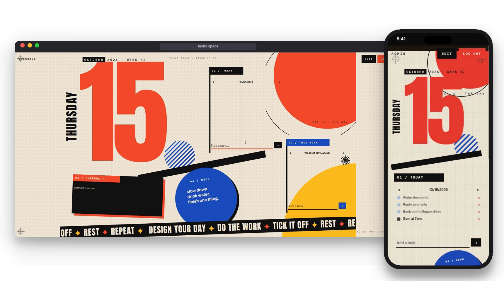</p>

## 📖 About

Tasks Space keeps track of what needs doing today and this week. The task lists
themselves are simple. What makes it different is the board around them: every
block can be moved, resized and restyled, so the tracker looks exactly the way
you want.

Each account has its own private board, with separate layouts for desktop and
phone. Next to the task lists you can put notes, images, an overdue list and
blocks with your own HTML, CSS and JavaScript.

## 💡 Why I built it

I wanted a tracker I would enjoy opening every day. Most task apps look the same
and only let you pick a theme color. I liked the idea of old MySpace pages, where
you could make a page completely your own, and wanted the same freedom for a tool
I use every day.

Not everyone wants to write CSS to get there, so the board has a built-in AI
assistant. You describe the look you want in plain words, and it changes the
board for you.

## 🎬 A quick tour

**Plan the day.** Add a task, tick it off, move on. This board is styled as a
Windows 98 desktop, but the lists underneath are the same on every design: daily,
weekly and overdue tasks that stay with the account.

<p align="center">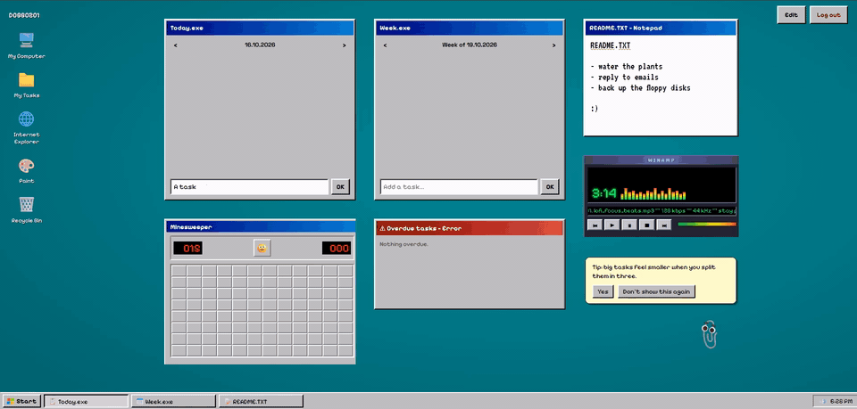</p>

**Change the whole look.** Saved designs live in one menu. Pick another one and
the layout, background, fonts and buttons all switch at once, here from Windows 98
to a Bauhaus poster.

<p align="center">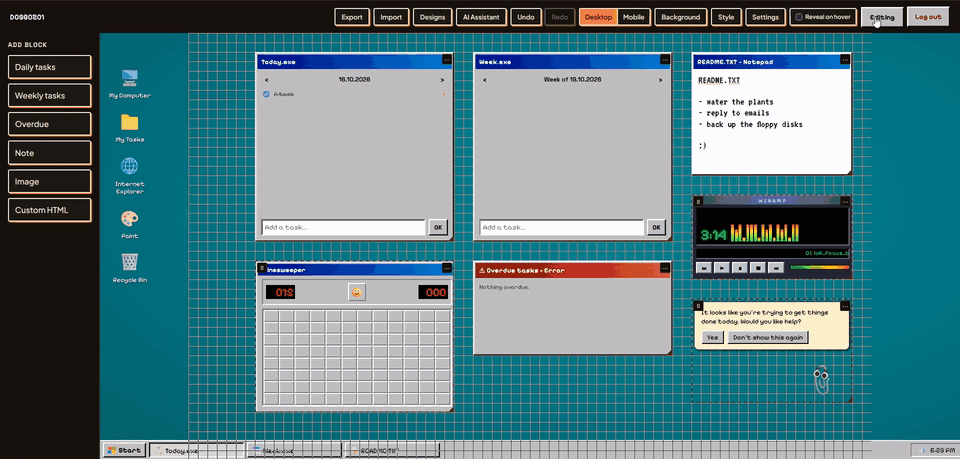</p>

**Build it yourself.** Edit mode turns the board into a canvas with a grid. Add
blocks from the sidebar, drag and resize them, and drop in your own images.

<p align="center">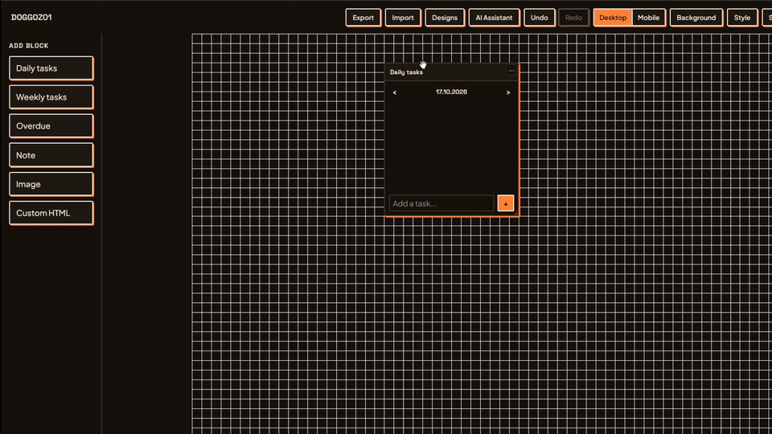</p>

## ✨ Features

Daily and weekly lists switch between dates, and a day locks once it is over. An
overdue block collects whatever was left behind. Around the lists you can place
notes, images and custom HTML blocks, so a board can
hold a calendar, a habit tracker or a working Minesweeper next to the real tasks.

Styling goes down to single blocks: colors, borders, custom CSS, layers, hover
effects, CSS animations and any Google Fonts family. The background can be a
color, an image or animated HTML. A finished look is saved as a design and can be
switched back in one click or exported as a JSON file.

<p align="center">
  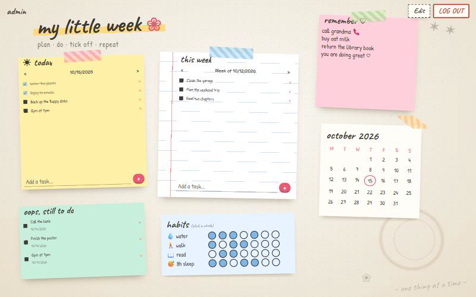
  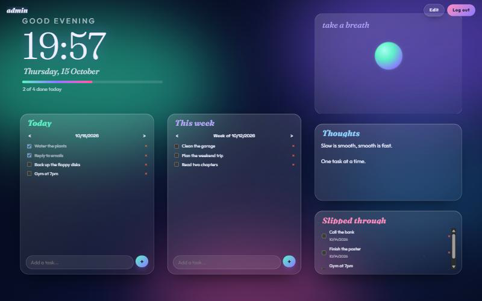
</p>

The phone gets its own board instead of a squeezed copy of the desktop one, and a
design file can carry both layouts at once. The built-in AI assistant changes the
board from a plain description, with your own API key or one set on the server.

<p align="center">
  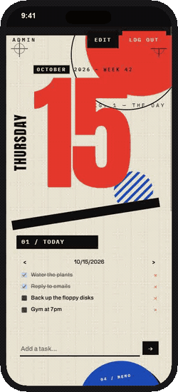
  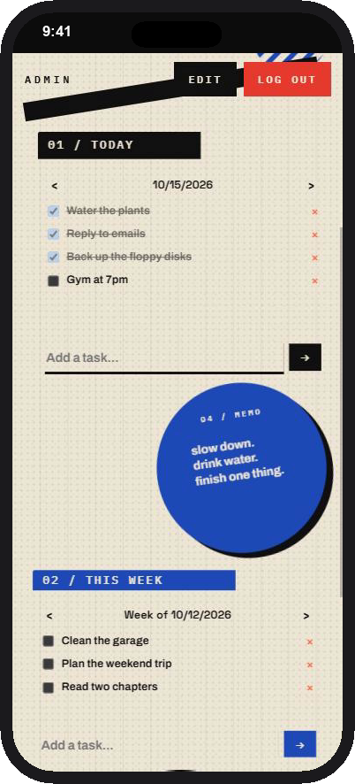
  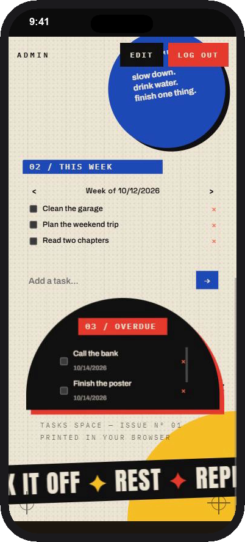
</p>

<p align="center">
  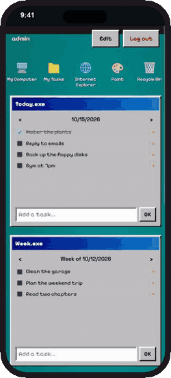
  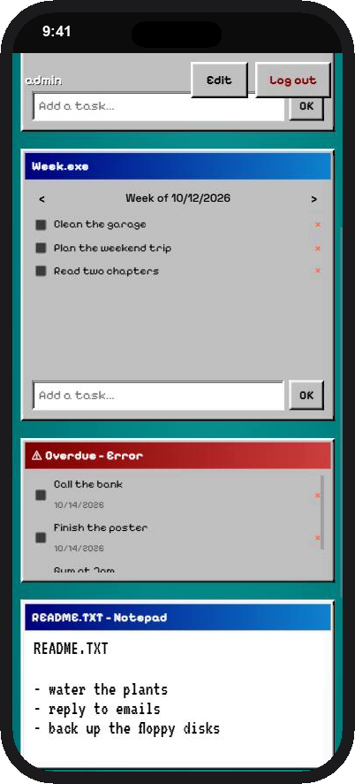
  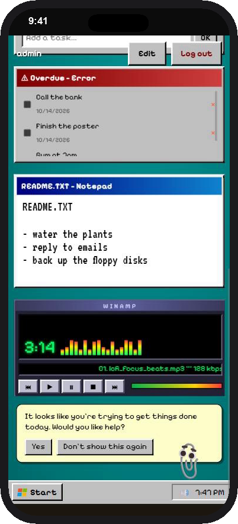
</p>

The designs shown here are in [`docs/designs/`](docs/designs). Import any of them
with **Edit → Import** to try it on your own board.

## 🧰 Tech stack

| Layer | Technology |
|---|---|
| Backend | Django, Django REST Framework |
| Frontend | React, TypeScript, Vite, craft.js |
| Sanitizing | bleach, tinycss2 |
| Auth | JWT in httpOnly cookies, CSRF protection |
| Database | SQLite |
| Deployment | Docker Compose with nginx, or gunicorn + pm2 on a VPS |
| Setup | Python installer with a terminal and a web wizard |

## 🧠 Technical decisions

**Everything is sanitized on the server.** Styles, custom CSS and HTML go through
allowlist sanitizers when they are saved and again every time they are read. The
check on read is what makes the custom scripts setting a real switch: turning it
off stops already saved scripts from being served.

**User HTML runs in a sandbox.** Custom HTML blocks, animated backgrounds and
overlays are served by the backend as separate documents with their own Content
Security Policy and shown in sandboxed iframes. They can't reach the page, its
cookies or other blocks. Scripts in them run only when the server allows it.

**Tokens in httpOnly cookies.** The frontend never reads the JWT. A script injected
into the page can't steal the session the way it could with a token in
`localStorage`.

**Separate desktop and phone boards.** A free-form canvas does not reflow well to a
narrow screen, so each device keeps a layout of its own.
## 🏗️ Architecture

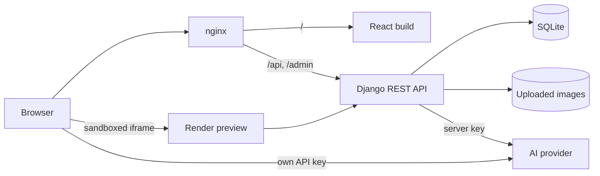

```
Tasks Space/
├── backend/     Django REST API: auth, boards, tasks, designs, uploads, sanitizers
├── frontend/    React client: board editor, blocks, AI assistant
├── installer/   Setup wizard for the Docker deployment (terminal and web)
└── nginx/       Reverse proxy and security headers
```

## 💻 Running locally

> [!CAUTION]
> ### Custom JavaScript
>
> Blocks and backgrounds can run your own `<script>` code when
> `ALLOW_CUSTOM_SCRIPTS=True`. It is off by default. The scripts run in a sandbox,
> but anyone who can edit a board can then run JavaScript for everyone who views
> it. **Turn it on only for an instance that is yours alone. Never on a shared or
> public one.**

More details in [`backend/README.md`](backend/README.md) (admin, registration,
environment variables), [`frontend/README.md`](frontend/README.md) and
[`installer/README.md`](installer/README.md) (Docker, domain and HTTPS).

### Without Docker

Requires Python 3.12+ and Node.js 20.19+. Two terminals:

```bash
# 1) backend
cd backend
python -m venv venv && source venv/Scripts/activate
pip install -r requirements.txt
cp .env.example .env    # then set SECRET_KEY and JWT_SIGNING_KEY
python manage.py migrate
python manage.py createsuperuser
python manage.py runserver

# 2) frontend
cd frontend
npm install
npm run dev
```

Open `http://localhost:5173` and log in with the superuser.

### 🐳 With Docker

Requires Docker with Docker Compose. From the repo root:

```bash
./install.sh      # Windows: .\install.ps1
```

On the first run the script asks how you want to set things up:

- **Web wizard.** Opens `http://localhost:7000` in your browser. It is a step by
  step form: local or real domain, admin account, security, day lock, AI
  assistant and limits, with a review screen at the end. Nothing is written until
  you click Install. A loading screen follows while the stack starts, then you are
  redirected to the site. The wizard shuts itself down afterwards. It only listens
  on `127.0.0.1`, so it is meant for your own machine.
- **Terminal wizard.** The same questions right in the console, with a review and a
  confirmation before anything is written. This is the easiest option on a remote
  server over SSH.

Either way the script then builds and starts the containers, waits for the
backend and prints the addresses the site is reachable at. With a domain set, it
also prints a ready nginx config and the certbot command. Running `./install.sh`
again later just starts the stack. Settings can be changed later with the same
wizard, see [`installer/README.md`](installer/README.md).

## 🛠️ How I work

I design the architecture, pick the stack and work out the interface myself before
any code is written. AI is part of my workflow as a coding assistant: I give it
well-defined pieces of work, review what comes back and use it to write unit tests.
The interface is tested by hand in the browser and on a phone. Deployment I handle
myself, on a Linux VPS.

## 📬 Contact

[LinkedIn](https://www.linkedin.com/in/aleksandr-kuznetsov-018006358/) · [doggoz01@proton.me](mailto:doggoz01@proton.me)

## 📄 License

[PolyForm Noncommercial 1.0.0](LICENSE): free for personal and other noncommercial use. Selling the code or using it in a commercial product is not allowed.
